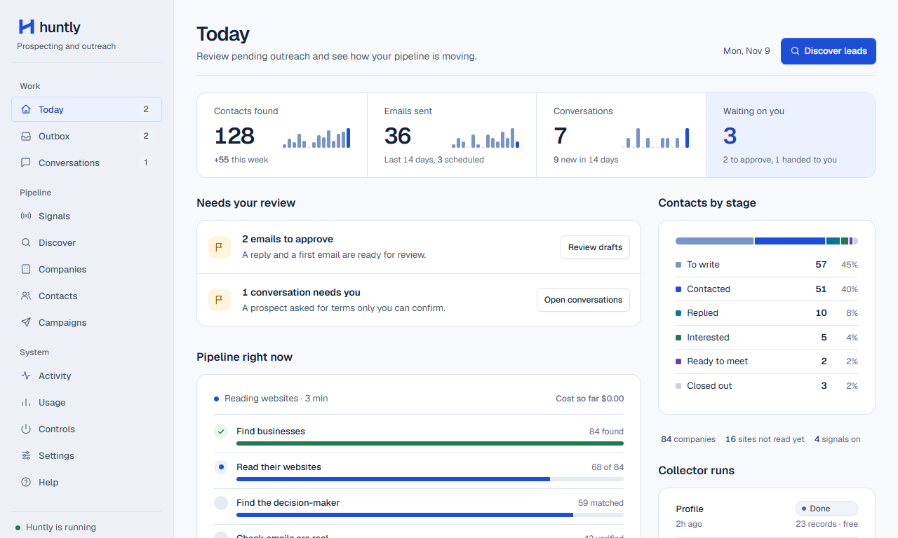
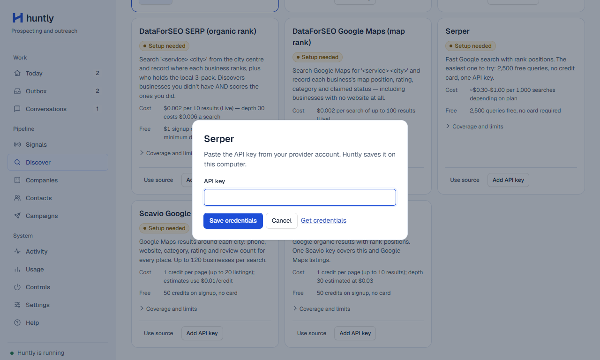
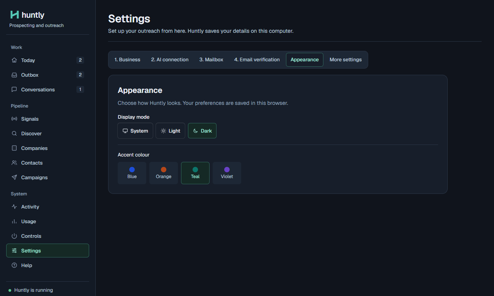

<h1>
  <picture>
    <source media="(prefers-color-scheme: dark)" srcset="docs/brand/huntly-wordmark-white.svg">
    
  </picture>
</h1>

**The outreach platform that runs on your Claude or ChatGPT plan.**

An independent fork of Sellbird, maintained by [Build with Mehar](https://github.com/buildwithmehar).

Huntly finds companies that need what you sell, finds the person who decides, checks their email address, writes each one a personal cold email, sends it and handles the replies. It runs locally on your own machine, and by default nothing goes out until you approve it.

[Download for Windows](https://github.com/buildwithmehar/huntly-desktop/releases/latest/download/Huntly-Setup.exe) · [Run in your browser](#run-in-your-browser) · [Watch the demo](docs/media/huntly-demo.mp4)



---

## What it does

Huntly is an end-to-end autonomous sales pipeline:

| Stage | What happens |
|---|---|
| **Find companies** | Searches for businesses that match your customer profile: free on OpenStreetMap or via search integrations. |
| **Learn why they'd buy** | Reads each company's website for buying signals (e.g. ads running, hiring, tooling). |
| **Find who decides** | Finds the owner or decision-maker named on company pages. |
| **Check the address** | Identifies email patterns and verifies deliverability (verified, risky, guess, invalid). |
| **Write and send** | Writes tailored cold email sequences from research, sending via Gmail, Microsoft 365, or SMTP. |
| **Handle replies** | Categorizes replies, drafts responses, handles objections, and pauses on opt-outs. |

---

## Quick Start

### Install the Windows app

1. Download [Huntly Setup](https://github.com/buildwithmehar/huntly-desktop/releases/latest/download/Huntly-Setup.exe) for 64-bit Windows 10 or 11.
2. Run the installer and open **Huntly** from the Start menu. Python is included.
3. Click **Continue setup** on Today. Connect the services you plan to use.

The desktop app stores its workspace under `%APPDATA%\huntly`. If you start the automation in **Controls**, use **Stop Huntly** when you want it to stop. Closing the window closes the dashboard while the running automation continues on this PC. The installer is unsigned. The [GitHub release](https://github.com/buildwithmehar/huntly-desktop/releases/latest) includes its SHA-256 checksum.

### Run in your browser

The browser dashboard runs on your computer. On Windows, install Python 3.11 or newer and double-click [Open Huntly.cmd](Open%20Huntly.cmd) in the source folder. Keep its terminal window open while you use the dashboard.

**macOS and Linux.** From the Huntly folder, install and open the dashboard.

```bash
python3 -m venv .venv
.venv/bin/python -m pip install -e .
.venv/bin/huntly dashboard --open
```

In the dashboard, click **Continue setup** on Today.

1. **Business.** Enter what you sell, who you want to reach, and the name and email address you send from.
2. **AI connection.** Choose your provider. For Claude Code, install it once, then use **Sign in to Claude** and **Check connection** in the dashboard.
3. **Mailbox.** Choose your email provider. Gmail and Microsoft 365 ask for app credentials from their account consoles before sign-in.
4. **Email verification.** Paste a key from Reoon, ZeroBounce or Hunter.

Today shows any remaining mailbox warmup steps. Review what to look for in **Signals**. Then use **Discover** to find businesses or click **Start Huntly** in **Controls** to run the automation. By default, new drafts wait for your review in the Outbox.

### A look inside

| Discover source credentials | Settings appearance |
| --- | --- |
|  |  |

The screenshots and [short walkthrough](docs/media/huntly-demo.mp4) use sample data. The walkthrough shows the Today dashboard, adding a source key, and changing the accent in **Settings → Appearance**.

---

## Commands Reference

- `huntly dashboard`: Open the local web dashboard.
- `huntly run`: Start the automated outreach loop.
- `huntly train <url>`: Train Huntly on your website / product offering.
- `huntly status`: View pipeline status and counts.
- `huntly discover`: Discover target companies based on ICP.
- `huntly outbox`: Review and approve queued emails.
- `huntly export`: Export prospects to a CSV file.
- `huntly sending pause/resume`: Control email sending killswitch.

---

## Safety & Autopilot

New outreach drafts wait in the Outbox for approval by default. Huntly validates drafts before sending. See [approval and sending](docs/approval-and-sending.md) for the sending modes and controls.

## Build from source

To rebuild the Windows installer, install Python 3.11 x64 and NSIS 3, then run this in PowerShell from the repository root.

```powershell
pwsh -File scripts/windows/build.ps1
```

The script builds `dist/Huntly-Setup.exe` and its SHA-256 checksum. Use the source tag from the release to build that version.

## License and credits

Huntly is an independent fork of Sellbird, formerly Harvey. It includes the Huntly branding, dashboard and onboarding updates, and Windows desktop packaging. [Upstream project](https://github.com/ethanplusai/sellbird) · [Original commit history](https://github.com/buildwithmehar/huntly-desktop/tree/previous-history)

Huntly is licensed under AGPL-3.0-only. [License](LICENSE) · [Copyright notices](NOTICE)
